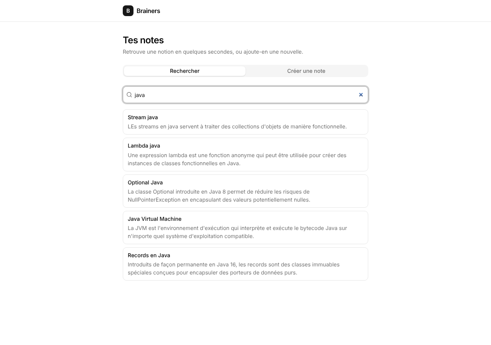
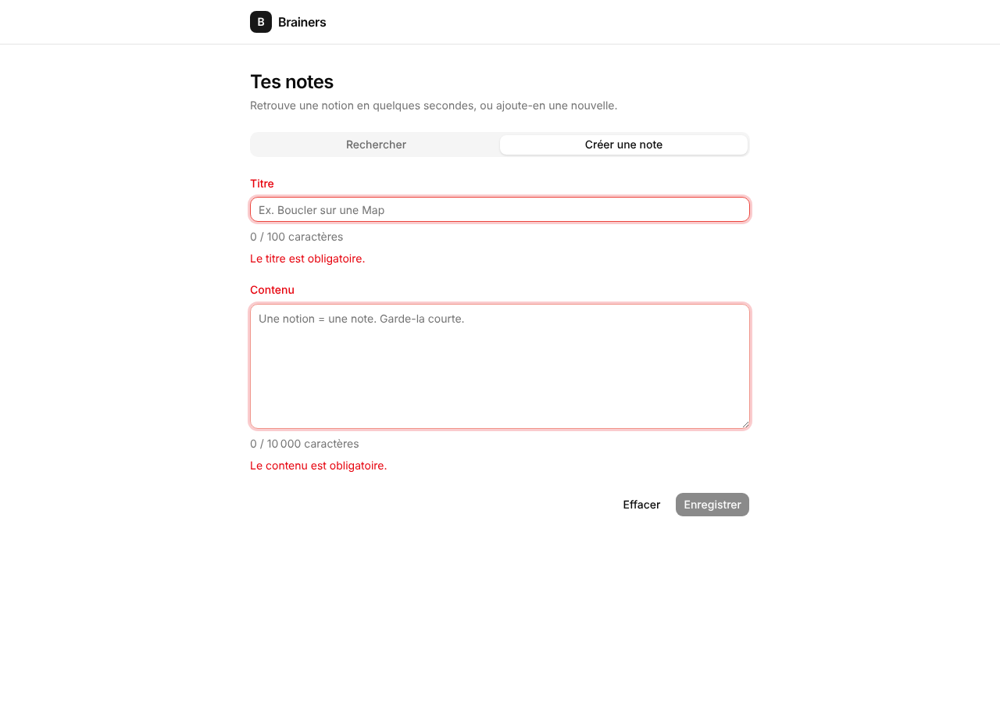
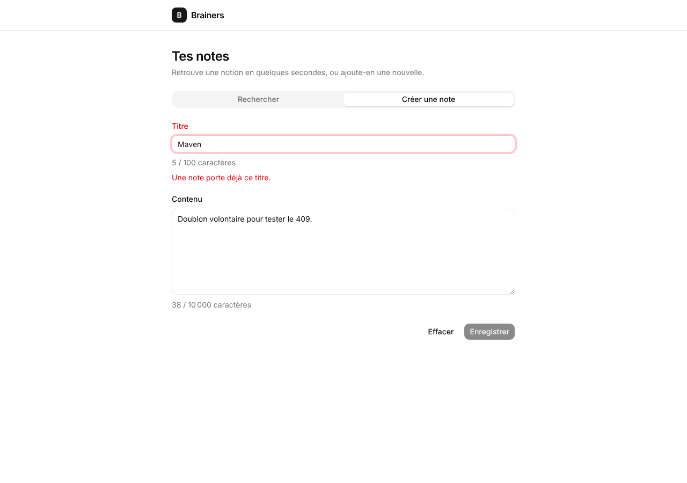
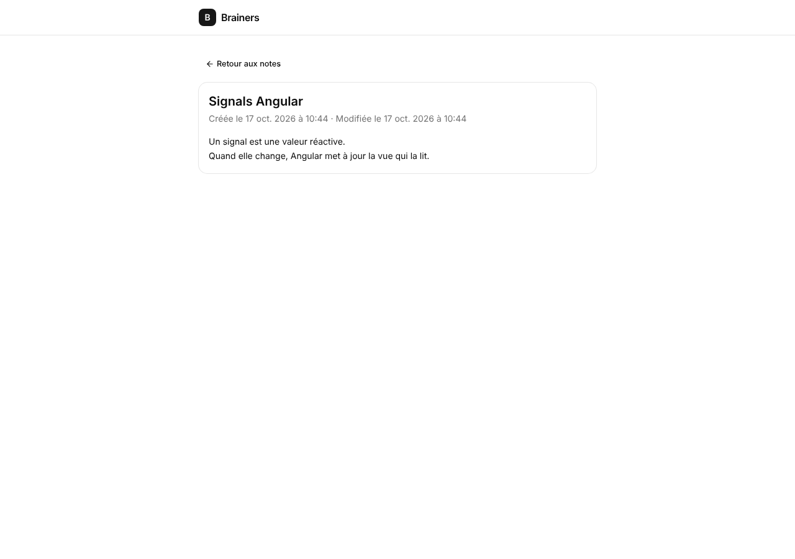
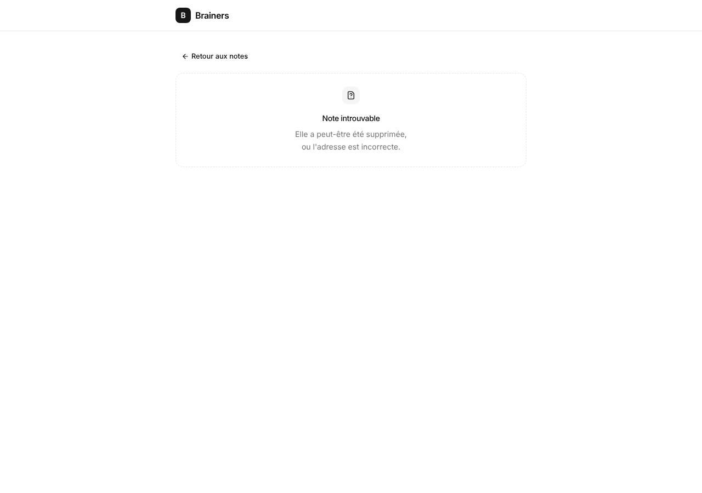
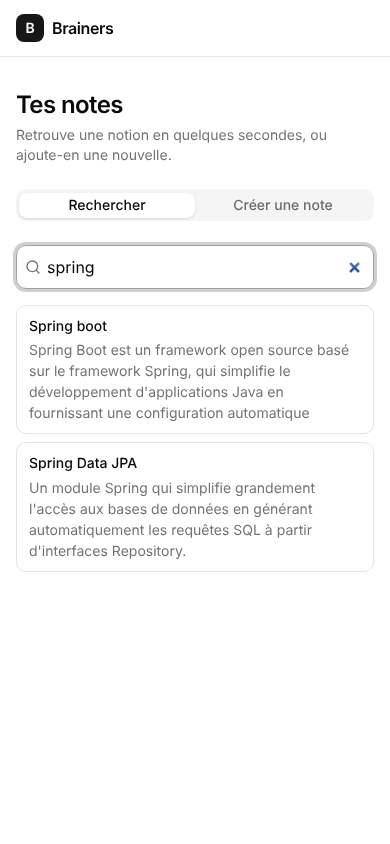

# Brainers front — le guide

> **Angular 22 · Spartan UI 1.8 · Tailwind v4 · Vitest** · branché sur ton back `demo/` (commit `3fe1664`)
> Ce guide accompagne le code du dossier `front/`. Le code est commenté ; le guide explique **pourquoi** il est écrit comme ça, et **comment on y arrive**.

**Ce qui a été vérifié :** le build de production passe, les **26 tests unitaires** passent (couverture 100 % du code applicatif, seuil fixé à 80 %), et un **parcours complet dans un vrai navigateur** (23 vérifications : délai de recherche, 10 résultats max, 409, 404, mobile…) passe contre un faux back qui reproduit exactement ton contrat (mêmes routes, même JSON, mêmes erreurs, lus dans ton code).
**Ce qui n'a pas pu l'être :** ton vrai back Spring n'a pas tourné de mon côté (l'accès à Maven Central est bloqué dans mon environnement). Le premier lancement chez toi est donc le vrai test d'intégration.

---

## Sommaire

0. [L'application en 3 écrans](#0-lapplication-en-3-écrans)
1. [Comment on pense un projet Angular](#1-comment-on-pense-un-projet-angular)
2. [L'architecture](#2-larchitecture)
3. [Les briques d'Angular, une par une](#3-les-briques-dangular-une-par-une)
4. [Le lien avec le back](#4-le-lien-avec-le-back)
5. [Fichier par fichier](#5-fichier-par-fichier)
6. [Lancer le projet et pièges](#6-lancer-le-projet-et-pièges)
7. [Les tests du front](#7-les-tests-du-front)
8. [Refaire ta version, étape par étape](#8-refaire-ta-version-étape-par-étape)
9. [Pour aller plus loin](#9-pour-aller-plus-loin)
10. [Glossaire](#10-glossaire)

---

## 0. L'application en 3 écrans

| Écran | URL | Ce qu'on y fait |
| :--- | :--- | :--- |
| Accueil, onglet **Rechercher** | `/` | Taper un mot du titre → après 300 ms sans frappe, 10 résultats max s'affichent sous la barre |
| Accueil, onglet **Créer une note** | `/` | Formulaire titre + contenu, obligatoires, validés avant envoi |
| **Détail** d'une note | `/notes/:id` | Titre, contenu, dates. « Note introuvable » si elle n'existe pas |

| Recherche | Formulaire (erreurs) | Titre déjà pris (409) |
| :---: | :---: | :---: |
|  |  |  |

| Détail | Introuvable | Mobile |
| :---: | :---: | :---: |
|  |  |  |

Toutes les captures sont dans `docs/captures/`.

---

## 1. Comment on pense un projet Angular

### 1.1 La méthode : du besoin au code, dans cet ordre

On ne commence **jamais** par le code ni par le style. On descend du besoin vers les fichiers :

```text
 1. LES BESOINS        Qu'est-ce que l'utilisateur veut faire ?          (tes user stories)
        │
        ▼
 2. LES ÉCRANS         Sur quels écrans le fait-il ?
        │
        ▼
 3. LES ROUTES         Quelle URL pour chaque écran ?                     → app.routes.ts
        │
        ▼
 4. LES COMPOSANTS     Comment découper chaque écran en morceaux ?        → pages/ + components/
        │
        ▼
 5. LES DONNÉES        Quelles données, venant d'où ? Quel contrat        → data/
        │              avec le back ? Qui fait les appels HTTP ?
        ▼
 6. LES ÉTATS          Pour chaque écran : chargement ? vide ? erreur ?   → les types d'état
        │
        ▼
 7. LE STYLE           Seulement maintenant : l'habillage (Spartan)       → templates
```

Les étapes 5 et 6 sont celles qu'on oublie, et ce sont celles qui font la différence entre une démo et une application propre.

### 1.2 Appliquée à Brainers

**Étape 1 → 2 : besoins → écrans.** Tu as demandé : rechercher, créer, afficher. Ça donne deux écrans : une page d'accueil (rechercher **ou** créer, deux onglets) et une page de détail.

**Étape 3 : écrans → routes.**

| Écran | Route | Pourquoi une URL à part ? |
| :--- | :--- | :--- |
| Accueil | `/` | Point d'entrée |
| Détail | `/notes/:id` | Une note doit avoir une **adresse** : on peut la mettre en favori, la partager, revenir en arrière avec le navigateur |

Les onglets n'ont **pas** d'URL : ce sont deux vues du même écran. Créer une route `/notes/new` aurait aussi été valable (voir 1.3).

**Étape 4 : écrans → composants.**

```text
 App  (la coquille : en-tête + <router-outlet>)
  │
  ├── "/"  HomePage ─────────────── la page : assemble et orchestre
  │         ├── NoteSearch ─────────── la barre + la recherche (appelle le back)
  │         │     └── NoteList ──────── affiche une liste (n'appelle rien)
  │         └── NoteCreateForm ─────── le formulaire (appelle le back)
  │
  └── "/notes/:id"  NoteDetailPage ── la page de détail (appelle le back)
```

Comment décider où couper ? Deux questions :

1. **Ce morceau a-t-il une responsabilité à lui ?** La recherche et la création sont deux métiers différents → deux composants.
2. **Ce morceau pourrait-il servir ailleurs ?** La liste de notes pourrait s'afficher sur une autre page → composant à part, qui ne fait **qu'afficher**.

**Étape 5 : les données.**

- Le contrat : deux types TypeScript qui recopient ton JSON (`Note` ⇔ `NoteResponse`, `NoteRequest` ⇔ `NoteRequest`).
- Un seul service fait les appels HTTP : `NoteApi`. Aucun composant ne connaît une URL.

**Étape 6 : les états.** Pour chaque écran, on liste tout ce qui peut s'afficher, **avant** de coder :

| Écran | États possibles |
| :--- | :--- |
| Recherche | champ vide · recherche en cours · résultats · aucun résultat · erreur |
| Formulaire | invalide · valide · envoi en cours · titre déjà pris (409) · erreur serveur |
| Détail | chargement · note affichée · introuvable (404) · erreur |

Chacun de ces états a son affichage dans le template, et la plupart ont leur test (section 7).

**Étape 7 : le style.** Spartan UI fournit les briques (onglets, champ, bouton, carte…). Tailwind gère la mise en page.

### 1.3 Les décisions et leurs alternatives

| Décision | Alternative écartée | Pourquoi |
| :--- | :--- | :--- |
| Recherche faite **par le back** (`GET /notes?title=`) | Charger toutes les notes et filtrer dans le front | La règle de recherche (RG6) vit à un seul endroit, et ça tient la charge avec 10 000 notes. Ton back avait déjà la route. |
| Limite de **10 résultats** appliquée dans le front | La limite dans le back (`findTop10By…`) | Ton back renvoie tous les résultats. Le front coupe à 10 et affiche « 10 premiers résultats sur 15 ». Idéalement, la limite descend dans le back (voir 4.6). |
| **Onglets** sur la page d'accueil | Une route `/notes/new` pour le formulaire | Tu voulais « une page principale où je peux soit rechercher, soit créer ». Les deux onglets gardent leur état quand on passe de l'un à l'autre. |
| Après création → **page de détail** | Rester sur le formulaire avec un message | C'est ton US-01 (critère 1). |
| **Proxy** de développement | Configurer CORS dans Spring | Zéro modification du back, et c'est l'approche standard d'Angular (voir 4.2). |
| Un **type d'état** par écran (`'loading' \| 'success' \| …`) | Plusieurs booléens (`loading`, `error`, `notFound`…) | Avec des booléens, on peut se retrouver avec `loading` ET `error` à `true`. Avec un type d'état, un seul état existe à la fois (voir 3.10). |
| `NoteList` séparé de `NoteSearch` | Tout dans `NoteSearch` | Séparer « chercher » et « afficher » : la liste est réutilisable et testable seule. |

---

## 2. L'architecture

### 2.1 L'arborescence commentée

```text
front/
├── proxy.conf.json              /api/* → http://localhost:8080/*  (développement)
├── angular.json                 configuration du CLI (build, serve, test)
├── components.json              configuration de Spartan (où il copie ses composants)
├── libs/ui/                     composants Spartan copiés dans TON projet (modifiables)
│   ├── button/  input/  field/  tabs/  card/  …
│   └── utils/                   fonction utilitaire de fusion des classes Tailwind
└── src/
    ├── index.html               LA seule page HTML (Angular remplit <app-root>)
    ├── main.ts                  démarre l'application
    ├── styles.css               Tailwind + thème Spartan (couleurs en variables CSS)
    ├── environments/            URL de l'API selon l'environnement
    └── app/
        ├── app.ts / app.html    coquille : en-tête + <router-outlet>
        ├── app.config.ts        ce qui est branché au démarrage
        ├── app.routes.ts        table des routes
        ├── notes/               ── la « feature » notes : tout ce qui la concerne ──
        │   ├── data/
        │   │   ├── note.model.ts      contrat avec le back (types)
        │   │   ├── note.rules.ts      règles RG1/RG2 (longueurs max)
        │   │   └── note-api.ts        LE service HTTP
        │   ├── pages/                 composants liés à une URL
        │   │   ├── home-page/
        │   │   └── note-detail-page/
        │   └── components/            morceaux d'écran
        │       ├── note-search/
        │       ├── note-list/
        │       └── note-create-form/
        └── shared/
            └── validators/            validateurs réutilisables par toute l'app
```

**Le principe : ranger par fonctionnalité, pas par type de fichier.** Tout ce qui concerne les notes est dans `notes/`. Le jour où tu ajoutes des tags, tu crées `tags/` à côté, avec la même structure interne.

### 2.2 Qui a le droit d'appeler qui

```text
   pages/           (HomePage, NoteDetailPage)
     │  utilisent
     ▼
   components/      (NoteSearch, NoteCreateForm, NoteList)
     │  utilisent
     ▼
   data/            (NoteApi, Note, NOTE_RULES)
     │  utilise
     ▼
   HttpClient  ───────────────▶  le back Spring
```

- On descend, on ne remonte **jamais** : `data/` ne connaît aucun composant.
- Une page peut aussi utiliser `data/` directement : `NoteDetailPage` appelle `NoteApi` sans passer par un composant.
- Un composant ne parle jamais directement à `HttpClient` : il passe par `NoteApi`.
- Pour prévenir un parent, un enfant **émet un événement** (`output()`), il ne l'appelle pas.

### 2.3 Le parallèle avec ton back Spring

Tu connais déjà la moitié de l'architecture :

| Spring (ton back) | Angular (ce front) | Rôle commun |
| :--- | :--- | :--- |
| `@GetMapping("/notes/{id}")` | `{ path: 'notes/:id', component: … }` | Associer une URL à un traitement |
| `@RestController` | Page / composant | Recevoir les actions (requête HTTP / clic, frappe) |
| `@Service` + injection par constructeur | `@Service()` + `inject(NoteApi)` | Une instance unique, injectée là où on en a besoin |
| `NoteRepository` (accès à la base) | `NoteApi` (accès au back) | Le seul endroit qui va chercher les données |
| `NoteResponse` / `NoteRequest` (DTO) | `Note` / `NoteRequest` (interfaces) | Le format des données échangées |
| `@NotBlank`, `@Size` (Bean Validation) | `Validators.required`, `Validators.maxLength` | Valider la saisie |
| `@RestControllerAdvice` | `catchError` + états d'erreur | Traduire les erreurs pour l'utilisateur |
| JUnit + Mockito | Vitest + `HttpTestingController` | Tester en remplaçant ce qui est extérieur |

### 2.4 Ce que tu peux ignorer pour l'instant

Générés par le CLI, rarement modifiés : `tsconfig*.json`, `.postcssrc.json` (branche Tailwind), `.editorconfig`, `.prettierrc` (formatage), `.vscode/` (recommande l'extension Angular Language Service à VS Code), `public/` (fichiers copiés tels quels, ex. favicon), `package-lock.json`.

---

## 3. Les briques d'Angular, une par une

Chaque brique : d'abord le concept seul, puis où elle est utilisée dans Brainers.

### 3.1 Le composant

**Le concept.** Un composant = une classe TypeScript (les données et les actions) + un template HTML (l'affichage) + un nom de balise (le `selector`).

```text
        note-list.ts                          note-list.html
 ┌────────────────────────────┐       ┌─────────────────────────────────┐
 │ @Component({               │       │ <ul>                            │
 │   selector: 'app-note-list'│──────▶│   @for (note of notes(); …) {   │
 │   imports: [...],          │       │     <li>{{ note.title }}</li>   │
 │   templateUrl: …           │       │   }                             │
 │ })                         │       │ </ul>                           │
 │ class NoteList {           │       └─────────────────────────────────┘
 │   notes = input.required() │   La classe fournit les données,
 │ }                          │   le template les affiche.
 └────────────────────────────┘
            │
            ▼  utilisé ailleurs comme une balise :   <app-note-list [notes]="…" />
```

- `imports` : tout ce que le template utilise (autres composants, directives Spartan, pipes). Si tu l'oublies, Angular refuse de compiler : il ne connaît pas la balise.
- Les composants sont **standalone** (pas de `NgModule`) : c'est la norme depuis Angular 17. Si tu vois des `@NgModule` à l'ADSN, c'est l'ancienne manière.

**Dans Brainers.** 6 composants : `App`, `HomePage`, `NoteDetailPage`, `NoteSearch`, `NoteList`, `NoteCreateForm`.

> **Conventions Angular 22.** Le CLI génère `note-list.ts` avec la classe `NoteList`. Dans les projets plus anciens (et sans doute à l'ADSN), tu verras `note-list.component.ts` avec `NoteListComponent` : c'est le même principe, seul le nom change (option `--file-name-style-guide=2016` de `ng new`).

### 3.2 Le template

**Le concept.** Le template est du HTML enrichi. Quatre syntaxes à connaître :

| Syntaxe | Sens | Exemple dans Brainers |
| :--- | :--- | :--- |
| `{{ expr }}` | Afficher une valeur | `{{ current.note.title }}` |
| `[prop]="expr"` | Donner une valeur à une propriété (sens classe → template) | `[notes]="current.notes"`, `[disabled]="form.invalid"` |
| `(event)="action()"` | Réagir à un événement (sens template → classe) | `(click)="clear()"`, `(created)="openNote($event)"` |
| `[formControl]`, `formControlName` | Relier un champ à un contrôle de formulaire | `formControlName="title"` |

Et le **contrôle de flux** :

| Bloc | Rôle | Exemple |
| :--- | :--- | :--- |
| `@if (cond) { } @else { }` | Afficher sous condition | Résultats ou « Aucune note trouvée. » |
| `@for (x of liste; track x.id) { }` | Répéter | Une ligne par note. `track` dit à Angular comment reconnaître chaque élément |
| `@switch (val) { @case ('a') { } }` | Un affichage par valeur | Un affichage par état de recherche |
| `@let nom = expr;` | Variable locale au template | `@let current = result();` |

**Les pipes** transforment une valeur à l'affichage : `{{ date | date: "d MMM y 'à' HH:mm" }}` → « 16 oct. 2026 à 09:49 », `{{ 10000 | number }}` → « 10 000 ».

### 3.3 Les signals

**Le concept.** Un signal est une **valeur qui prévient quand elle change**. Le template qui la lit se met à jour tout seul.

```ts
loading = signal(false);   // créer
loading();                 // lire  → false   (on l'appelle comme une fonction)
loading.set(true);         // écrire → tous les templates qui lisent loading() se mettent à jour
```

**Pourquoi c'est important en Angular 22.** Les nouveaux projets sont **zoneless** (sans `zone.js`) et les composants sont **OnPush par défaut**. Concrètement, un composant se redessine quand :

- un **signal** qu'il lit change ;
- un **événement** se produit dans son template (clic, frappe…) ;
- une de ses **entrées** (`input()`) change.

Règle pratique : **tout ce qui change avec le temps et s'affiche → un signal.** C'est pour ça que `loading`, `submitting` et `serverError` sont des signals : ils changent dans des callbacks HTTP, donc hors de tout événement de template.

**Le pont avec RxJS : `toSignal()`.** Il s'abonne à un Observable et expose sa dernière valeur sous forme de signal. Il se désabonne tout seul quand le composant disparaît.

```ts
protected readonly result = toSignal(observableDeResultats, { initialValue: IDLE });
// dans le template : result()
```

### 3.4 Parent ↔ enfant : `input()` et `output()`

**Le concept.** Les données descendent par les **entrées**, les événements remontent par les **sorties**.

```text
                 ┌──────────────────────────────┐
                 │ PARENT                       │
                 │                              │
   [notes]="…"   │                 (created)="openNote($event)"
   données ▼     │                        ▲ événement
 ┌───────────────┴──┐            ┌────────┴─────────────┐
 │ NoteList         │            │ NoteCreateForm       │
 │ notes = input()  │            │ created = output()   │
 │                  │            │ created.emit(note)   │
 └──────────────────┘            └──────────────────────┘
```

**Dans Brainers :**

- `NoteSearch` passe les notes trouvées à `NoteList` : `<app-note-list [notes]="current.notes" />`.
- `NoteCreateForm` émet la note créée ; `HomePage` écoute et navigue : `<app-note-create-form (created)="openNote($event)" />`.

**Pourquoi le formulaire ne navigue pas lui-même ?** Parce que « que faire après la création » est une décision de **page**. Si demain tu réutilises ce formulaire dans une fenêtre modale, il ne faudra pas naviguer, juste fermer la fenêtre. Le formulaire, lui, ne change pas.

### 3.5 Les services et l'injection de dépendances

**Le concept.** Un service est une classe sans affichage, avec **une seule instance** pour toute l'application, qu'Angular fournit à qui la demande. C'est exactement l'injection de dépendances de Spring.

```ts
@Service()                                   // Angular 22
export class NoteApi { … }

// Avant Angular 22 (et dans la plupart du code existant), même effet :
@Injectable({ providedIn: 'root' })
export class NoteApi { … }

// Pour l'utiliser, dans n'importe quel composant :
private readonly noteApi = inject(NoteApi);
```

`inject()` remplace l'injection par constructeur (qui marche aussi). On l'utilise dans la déclaration des champs, comme ici.

**Dans Brainers.** `NoteApi` est le seul service. Les composants injectent aussi des services fournis par Angular : `Router`, `ActivatedRoute`, `NonNullableFormBuilder`, `HttpClient` (dans `NoteApi`).

### 3.6 Le routeur

**Le concept.** Une application Angular est une **SPA** (Single Page Application) : il n'y a qu'**une** page HTML (`index.html`). Quand l'URL change, le navigateur ne recharge rien. Le routeur remplace le composant affiché dans `<router-outlet />`.

```text
 URL : /notes/12
   │
   ▼  le routeur parcourt app.routes.ts dans l'ordre
   { path: '', … }            ✗
   { path: 'notes/:id', … }   ✓  → id = "12"
   │
   ▼
 <router-outlet />  ← NoteDetailPage est créée ici
```

| Outil | Rôle | Dans Brainers |
| :--- | :--- | :--- |
| `Routes` | La table URL → composant | `app.routes.ts` |
| `<router-outlet />` | L'emplacement où s'affiche la page | `app.html` |
| `routerLink` | Un lien interne, sans rechargement | `[routerLink]="['/notes', note.id]"` |
| `router.navigate([...])` | Naviguer depuis le code | `HomePage.openNote()` |
| `ActivatedRoute.paramMap` | Lire les paramètres de l'URL | `NoteDetailPage` lit `id` |
| `{ path: '**', redirectTo: '' }` | URL inconnue → accueil | dernière route |

**Pourquoi `paramMap` (un Observable) et pas une lecture unique de l'URL ?** Si tu passes de `/notes/1` à `/notes/2`, Angular **réutilise** le même composant au lieu d'en créer un nouveau. Seul `paramMap` te prévient que l'id a changé.

### 3.7 HttpClient et les Observables

**Le concept.** `HttpClient` renvoie un **Observable** : une réponse à venir, **qui ne fait rien tant que personne ne s'y abonne**.

```ts
const obs = this.http.get<Note[]>('/api/notes');  // aucune requête n'est partie
obs.subscribe((notes) => …);                      // la requête part MAINTENANT
```

Trois façons de s'abonner, toutes présentes dans Brainers :

| Façon | Où | Désabonnement |
| :--- | :--- | :--- |
| `.subscribe({ next, error })` | `NoteCreateForm.submit()` | Inutile : un Observable HTTP se termine tout seul après la réponse |
| `switchMap(() => api.xxx())` | `NoteSearch`, `NoteDetailPage` | Géré par l'opérateur (et il annule la requête précédente) |
| `toSignal(obs)` | `NoteSearch`, `NoteDetailPage` | Automatique à la destruction du composant |

`get<Note[]>` est un **typage** : TypeScript te fait confiance, il ne vérifie rien à l'exécution. Si le back renvoie un autre JSON, l'erreur apparaîtra plus loin. D'où l'importance de `note.model.ts` (voir 4.3).

En cas d'erreur HTTP (404, 409, 500…), l'Observable émet une `HttpErrorResponse` dont tu lis le `status`.

### 3.8 La recherche : le pipeline RxJS pas à pas

**Le concept.** `valueChanges` est un Observable qui émet chaque nouvelle valeur du champ. On lui applique une chaîne d'**opérateurs**, comme un `stream()` Java sur une collection, mais dans le temps.

```ts
this.searchControl.valueChanges.pipe(
  map((value) => value.trim()),                  // 1. nettoyer
  debounceTime(SEARCH_DEBOUNCE_MS),              // 2. attendre 300 ms de calme
  distinctUntilChanged(),                        // 3. ignorer si identique
  switchMap((term) => (term === '' ? of(IDLE) : this.search(term))),  // 4. chercher
)
```

**Ce qui se passe quand tu tapes « java » vite**, sur une ligne de temps :

```text
temps          0    60   120  180          480 ms
frappes        j    ja   jav  java
               │    │    │    │
map(trim)      j    ja   jav  java
               │    │    │    │
debounce(300)  ✗    ✗    ✗    └──── 300 ms sans frappe ────▶ "java"
                                                              │
distinct                                                      "java"  (≠ précédent)
                                                              │
switchMap                                     GET /api/notes?title=java
                                                              │
                                                     [5 notes] → result()
```

Sans `debounceTime`, tu enverrais 4 requêtes. Avec, une seule.

**Pourquoi `switchMap` et pas `mergeMap` ?** Imagine : tu tapes « ja », la requête part, le back est lent ; tu tapes « java », une deuxième requête part et revient vite. Puis la réponse de « ja » arrive enfin…

```text
 mergeMap  :  résultats "java" affichés … puis ÉCRASÉS par les résultats de "ja"   ✗
 switchMap :  la requête "ja" est ANNULÉE dès que "java" arrive                   ✓
```

**Pourquoi le `catchError` est dans `search()` et pas à la fin du pipeline ?** Une erreur qui atteint le pipeline principal le **termine** : plus aucune frappe ne déclencherait de recherche. Placé dans la recherche, il transforme l'erreur en état `{ status: 'error' }` et le pipeline continue. Un test vérifie justement qu'une recherche fonctionne encore après une erreur.

**Le spinner.** `this.loading.set(true)` au départ de la recherche, `finalize(() => this.loading.set(false))` à la fin. `finalize` est appelé quand la requête se termine **ou** quand `switchMap` l'annule. Les anciens résultats restent affichés pendant le chargement, ce qui évite un clignotement.

**La limite de 10.** `notes.slice(0, SEARCH_MAX_RESULTS)`, et on garde `total` pour afficher « 10 premiers résultats sur 15 ».

### 3.9 Les formulaires réactifs

**Le concept.** Le formulaire est décrit **dans la classe** (le modèle), puis relié au HTML.

```ts
form = this.formBuilder.group({
  title:   ['', [Validators.required, notBlankValidator, Validators.maxLength(100)]],
  content: ['', [Validators.required, notBlankValidator, Validators.maxLength(10_000)]],
});
```

```html
<form [formGroup]="form" (ngSubmit)="submit()">
  <input formControlName="title" />
```

Chaque contrôle a un **état** que tu peux lire : `value`, `valid`/`invalid`, `errors`, `touched` (quitté au moins une fois), `dirty` (modifié).

**Les clés d'erreur** : chaque validateur ajoute une clé dans `errors` quand il échoue.

| Valeur saisie | `errors` | Message affiché |
| :--- | :--- | :--- |
| `""` | `{ required: true }` | Le titre est obligatoire. |
| `"   "` | `{ blank: true }` | Le titre ne peut pas contenir uniquement des espaces. |
| 101 caractères | `{ maxlength: {...} }` | Le titre ne doit pas dépasser 100 caractères. |
| `"Maven"` + réponse 409 | `{ duplicate: true }` | Une note porte déjà ce titre. |

**Pourquoi un validateur maison ?** `Validators.required` accepte `"   "` : pour lui, trois espaces ne font pas une chaîne vide. `notBlankValidator` comble ce trou (RG1/RG2). Un validateur n'est qu'une fonction : contrôle en entrée, `null` (OK) ou un objet d'erreurs en sortie.

**Quand les erreurs s'affichent-elles ?** Un message `<hlm-field-error validator="blank">` de Spartan s'affiche si le champ est **invalide** pour cette clé **et** a été **quitté** (touched). C'est exactement ton US-01 : « quand je quitte un champ qui ne respecte pas les règles ». On ne crie pas sur l'utilisateur pendant qu'il tape.

**L'erreur 409 placée sur le champ.** Le back répond « titre déjà pris » ; on fait `title.setErrors({ duplicate: true })`. Le message apparaît sous le titre, le bouton se désactive, et dès que l'utilisateur modifie le titre, les validateurs repassent et l'erreur disparaît.

**`NonNullableFormBuilder`** : après un `reset()`, les champs reviennent à `''` et pas à `null`. Tu évites des `null` partout dans ton code.

### 3.10 Modéliser les états d'un écran

**Le concept.** Au lieu de plusieurs booléens, un **type union** liste tous les états possibles. Un seul est vrai à la fois.

```ts
type DetailState =
  | { status: 'loading' }
  | { status: 'success'; note: Note }   // la note n'existe QUE dans cet état
  | { status: 'not-found' }
  | { status: 'error' };
```

```html
@switch (current.status) {
  @case ('loading')   { <hlm-spinner /> }
  @case ('success')   { … {{ current.note.title }} … }   <!-- TypeScript sait que note existe ici -->
  @case ('not-found') { Note introuvable }
  @case ('error')     { Impossible de charger la note. }
}
```

L'équivalent Java, c'est une `sealed interface` avec un `record` par état et un `switch` dessus. Avantages :

- **Tous les cas sont listés au même endroit** : un état sans affichage se repère tout de suite.
- **Impossible d'afficher une note inexistante** : `note` n'existe que dans l'état `success`, et le compilateur le vérifie.

**Une exception assumée, dans la recherche.** `loading` y est un signal séparé du résultat. Raison : pendant une nouvelle recherche, on veut **garder les anciens résultats affichés** (sinon la liste disparaît et réapparaît à chaque frappe). Le spinner dit « ça charge », la liste reste en place. Règle : un type d'état par défaut, et une information séparée seulement quand elle doit coexister avec les autres.

### 3.11 Spartan UI

**Le concept.** Spartan est le portage Angular de *shadcn/ui*. Il a deux couches :

| Couche | Où elle vit | Ce qu'elle apporte | Tu la modifies ? |
| :--- | :--- | :--- | :--- |
| **brain** (`@spartan-ng/brain`) | `node_modules` (installée par npm) | Le comportement et l'accessibilité : clavier, attributs ARIA, état des onglets, des champs | Non |
| **helm** (`@spartan-ng/helm/...`) | `libs/ui/` (**copiée dans ton projet**) | Le style : des classes Tailwind posées sur les éléments | Oui, c'est ton code |

L'import `@spartan-ng/helm/button` ressemble à un paquet npm, mais c'est un **alias** déclaré dans `tsconfig.json` qui pointe vers `libs/ui/button/src/index.ts`.

**L'utiliser : deux gestes.**

```ts
// 1. Importer dans le composant
imports: [HlmButtonImports],
```

```html
<!-- 2. Poser la directive sur un élément HTML natif -->
<button hlmBtn variant="ghost" size="sm">Effacer</button>
<a hlmBtn routerLink="/">Retour</a>            <!-- un lien qui a l'air d'un bouton -->
```

La plupart des composants Spartan sont des **directives** posées sur des balises normales (`<input hlmInput>`, `<div hlmCard>`). Ton HTML reste du HTML.

**Les composants utilisés dans Brainers :**

| Composant | Utilisé pour | Fichier |
| :--- | :--- | :--- |
| Tabs | Rechercher / Créer une note | `home-page.html` |
| Input Group + Input | Barre de recherche avec icône et spinner | `note-search.html` |
| Item | Une ligne de résultat | `note-list.html` |
| Empty | « Aucune note trouvée », « Note introuvable » | `note-search.html`, `note-detail-page.html` |
| Alert | Erreurs serveur | plusieurs |
| Spinner | Chargements | plusieurs |
| Field (+ Label) | Label, compteur et messages d'erreur d'un champ | `note-create-form.html` |
| Input, Textarea | Les champs du formulaire | `note-create-form.html` |
| Button | Tous les boutons, et le lien « Retour » | plusieurs |
| Card | La note affichée | `note-detail-page.html` |

**Ajouter un composant :** `npx ng g @spartan-ng/cli:ui dialog` (ou sans nom pour choisir dans une liste). Le CLI copie les fichiers dans `libs/ui/`, ajoute l'alias et installe les dépendances.

**Les icônes** viennent de `@ng-icons/lucide` : on déclare celles qu'on utilise (`providers: [provideIcons({ lucideSearch })]`) puis `<ng-icon name="lucideSearch" />`.

**Le thème** : les couleurs sont des variables CSS dans `src/styles.css` (`--primary`, `--destructive`, `--muted-foreground`…). Change une variable, tout suit.

### 3.12 Tailwind en 2 minutes

Tailwind = des **classes utilitaires** : chaque classe fait une seule chose, et on les combine directement dans le HTML.

| Classe | Effet |
| :--- | :--- |
| `flex flex-col gap-6` | Empiler les enfants verticalement, 1,5 rem d'écart |
| `mx-auto max-w-2xl px-4` | Colonne centrée de 42 rem max, marges latérales |
| `text-sm font-semibold` | Taille et graisse du texte |
| `text-muted-foreground` | Couleur « texte secondaire » du thème |
| `sr-only` | Invisible à l'écran, lu par les lecteurs d'écran (le label de la recherche) |
| `whitespace-pre-wrap` | Conserver les retours à la ligne du contenu |

---

## 4. Le lien avec le back

### 4.1 Le trajet complet d'une requête

Exemple : tu tapes « maven » dans la barre de recherche.

```text
 NAVIGATEUR (localhost:4200)
 ┌──────────────────────────────────────────────────────────────┐
 │ NoteSearch   frappe → 300 ms → switchMap                     │
 │      │                                                       │
 │      ▼                                                       │
 │ NoteApi.searchByTitle('maven')                               │
 │      │  http.get('/api/notes', { params: { title } })        │
 └──────┼───────────────────────────────────────────────────────┘
        │  GET /api/notes?title=maven
        ▼
 SERVEUR DE DÉVELOPPEMENT ANGULAR (ng serve, :4200)
 ┌──────────────────────────────────────────────────────────────┐
 │ proxy.conf.json : "/api" → http://localhost:8080             │
 │                   pathRewrite "^/api" → ""                   │
 └──────┼───────────────────────────────────────────────────────┘
        │  GET /notes?title=maven
        ▼
 SPRING BOOT (:8080)
 ┌──────────────────────────────────────────────────────────────┐
 │ NoteController.getAll(@RequestParam title)                   │
 │   → NoteService.getNotes(search)                             │
 │     → NoteRepository.findByTitleContainingIgnoreCase(search) │
 │       → H2 : SELECT … WHERE UPPER(title) LIKE '%MAVEN%'      │
 └──────┼───────────────────────────────────────────────────────┘
        │  200 [ { "id": 11, "title": "Maven", … } ]
        ▼
   … le même chemin en sens inverse …
        ▼
 NoteSearch : result() = { status: 'success', notes: [...] } → NoteList s'affiche
```

### 4.2 Pourquoi un proxy, et pourquoi `/api`

**Le problème : CORS.** Le front est servi par `localhost:4200`, le back par `localhost:8080`. Pour le navigateur, ce sont deux **origines** différentes. Par sécurité, il bloque les appels de l'un vers l'autre, sauf si le back l'autorise explicitement avec des en-têtes CORS.

**La solution en développement : le proxy.** Le navigateur appelle `localhost:4200/api/...`, donc la même origine, et rien n'est bloqué. C'est le serveur de développement d'Angular qui relaie la requête à Spring, de serveur à serveur, là où CORS ne s'applique pas.

```text
 Sans proxy :  navigateur ──✗ CORS──▶ :8080
 Avec proxy :  navigateur ──▶ :4200 ──(serveur à serveur)──▶ :8080
```

**Pourquoi le préfixe `/api` ?** Ta page de détail a l'URL `/notes/12`, et ta route API aussi : `/notes/12`. Sans préfixe, impossible pour le serveur de savoir si on demande la **page** (le HTML d'Angular) ou les **données** (le JSON de Spring). Avec `/api`, tout ce qui commence par `/api` part au back, le reste est la page Angular. Le `pathRewrite` retire `/api` avant de transmettre : ton back n'a **rien** à changer.

**Où est configuré quoi :**

| Fichier | Contenu |
| :--- | :--- |
| `src/environments/environment*.ts` | `apiUrl: '/api'` : le préfixe utilisé par `NoteApi` |
| `proxy.conf.json` | Où envoyer `/api` (`localhost:8080`) et la réécriture |
| `angular.json` → `serve.options.proxyConfig` | Active le proxy pour `ng serve` |

> En production, il n'y a plus de `ng serve` : un serveur web (Nginx, ou Spring lui-même) jouerait le même rôle de proxy. Le code du front ne change pas, puisqu'il appelle toujours `/api`.

### 4.3 Le contrat d'API

| Action | Front (`NoteApi`) | Requête | Back (`NoteController`) | Réponses |
| :--- | :--- | :--- | :--- | :--- |
| Rechercher | `searchByTitle(title)` | `GET /notes?title=…` | `getAll(search)` | `200` + liste (vide possible) |
| Consulter | `getById(id)` | `GET /notes/{id}` | `getById(id)` | `200` + note · `404` texte « Note not found » |
| Créer | `create(request)` | `POST /notes` + `{ title, content }` | `create(noteRequest)` | `201` + note · `409` texte « Note already exist » |

**Le JSON d'une note**, tel que ton back le renvoie :

```json
{
  "id": 11,
  "title": "Maven",
  "content": "Un outil de gestion et d'automatisation…",
  "createdAt": "2026-10-16T09:49:25.123456",
  "lastUpDateTime": "2026-10-16T09:49:25.123456"
}
```

⚠️ **`lastUpDateTime`** : Jackson construit les noms du JSON à partir des **getters** de `NoteResponse`, pas des champs. Ton getter s'appelle `getLastUpDateTime()`, donc la clé s'appelle `lastUpDateTime`. L'interface `Note` du front recopie ce nom. Si tu renommes le getter, renomme aussi la propriété dans `note.model.ts`. TypeScript te montrera alors tous les endroits à corriger.

### 4.4 Ce que voit l'utilisateur pour chaque réponse

Le front lit le **code HTTP**, jamais le texte du message (qui peut changer côté back).

| Situation | Réponse du back | Ce qui s'affiche |
| :--- | :--- | :--- |
| Recherche avec résultats | `200` + liste | Les notes (10 max) |
| Recherche sans résultat | `200` + `[]` | « Aucune note trouvée. » |
| Note ouverte | `200` + note | La carte de la note |
| Note inexistante | `404` | « Note introuvable » |
| URL `/notes/abc` | *(aucun appel)* | « Note introuvable » : le front ne demande même pas |
| Titre déjà pris | `409` | « Une note porte déjà ce titre. » sous le champ |
| Données refusées | `400` | Alerte « Le serveur a refusé la note… » |
| Back arrêté ou plantage | `500` / `502` / `0` | Alerte « Le serveur est injoignable ou a rencontré une erreur… » |

### 4.5 Les dates

Ton back envoie des `LocalDateTime` sous forme de texte ISO, sans fuseau : `"2026-10-16T09:49:25.123456"`. Le pipe `date` sait les lire. Pour l'affichage en français :

```ts
// app.config.ts
registerLocaleData(localeFr);                // les noms de mois, formats français
{ provide: LOCALE_ID, useValue: 'fr' },      // langue par défaut des pipes
```

```html
{{ note.createdAt | date: "d MMM y 'à' HH:mm" }}   →   16 oct. 2026 à 09:49
```

Le texte entre apostrophes (`'à'`) est recopié tel quel.

### 4.6 Ce que je te conseille de changer côté back

Le front fonctionne avec ton back **tel quel**. Ces changements le rendent plus solide :

1. **La colonne `content` est limitée à 255 caractères.** Sans `length`, Hibernate crée un `VARCHAR(255)`. Au-delà, l'insertion échoue et le front affiche « erreur serveur » (testé). Ta RG2 dit 10 000 :
   ```java
   @Column(nullable = false, length = 10000)
   private String content;
   ```
2. **Limiter et trier dans le back.** La règle des 10 résultats y a sa place (moins de données transférées) :
   ```java
   List<Note> findTop10ByTitleContainingIgnoreCaseOrderByLastUpdateAtDesc(String title);
   ```
   Le `slice(0, 10)` du front devient alors un simple filet de sécurité, et le message « 10 premiers sur N » ne s'affichera plus (le back ne renverra jamais plus de 10 notes).
3. **Une recherche vide.** `?title=` (chaîne vide) renvoie aujourd'hui toutes les notes. Le front n'envoie jamais de recherche vide, mais le back ne devrait pas en dépendre : `search == null || search.isBlank()`.
4. **La validation côté back.** `NoteRequest` n'a toujours aucune contrainte : n'importe qui peut créer une note au titre vide avec Postman. Le front valide pour le confort, **le back doit valider pour la sécurité** (`@NotBlank`, `@Size(max = 100)`).
5. **Titre unique ou pas ?** Ton entité impose un titre unique, ton README (RG5) dit le contraire. Le front gère le 409. Mets le README en accord avec ton choix.

---

## 5. Fichier par fichier

Ordre de lecture conseillé : du bas (les données) vers le haut (les pages).

| # | Fichier | Rôle | Ce qu'il faut y regarder |
| :---: | :--- | :--- | :--- |
| 1 | `notes/data/note.model.ts` | Le contrat JSON | `lastUpDateTime` et pourquoi |
| 2 | `notes/data/note.rules.ts` | RG1/RG2 | Une seule source pour les limites côté front |
| 3 | `notes/data/note-api.ts` | Les appels HTTP | Une méthode par route, chaque méthode commentée avec la route Spring |
| 4 | `shared/validators/not-blank.validator.ts` | Refuser `"   "` | Un validateur est une fonction pure |
| 5 | `notes/components/note-list/*` | Afficher une liste | `input.required`, `@for … track`, `routerLink` |
| 6 | `notes/components/note-search/*` | La recherche | Le pipeline RxJS (3.8), `loading`, `@switch` sur l'état |
| 7 | `notes/components/note-create-form/*` | La création | Le FormGroup, les `hlm-field-error`, le 409 placé sur le champ, `output()` |
| 8 | `notes/pages/home-page/*` | La page d'accueil | Les onglets, l'écoute de `(created)`, `router.navigate` |
| 9 | `notes/pages/note-detail-page/*` | Le détail | `paramMap`, l'id invalide, le type d'état à 4 cas |
| 10 | `app.routes.ts` | Les routes | L'ordre, `:id`, `**` |
| 11 | `app.config.ts` | Le démarrage | Les `provide…()` |
| 12 | `app.ts` / `app.html` | La coquille | `<router-outlet />` |
| 13 | `environments/*`, `proxy.conf.json`, `angular.json` | La configuration | Section 4.2 |
| 14 | `*.spec.ts` | Les tests | Section 7 |

---

## 6. Lancer le projet et pièges

### 6.1 Installation

1. **Copie le dossier `front/`** à la racine de ton repo, à côté de `demo/`. Il ne contient pas de dossier `.git` : il s'intègre à ton repo existant.
2. **Vérifie Node** : `node -v` doit afficher au moins `v22.22.3`, ou une version 24. Sinon, avec nvm (présent dans Codespaces) : `cd front && nvm install && nvm use` (la version est lue dans `.nvmrc`).
3. **Installe les dépendances** : `cd front && npm install`.

### 6.2 Lancement

```bash
# Terminal 1
cd demo && ./mvnw spring-boot:run          # back sur :8080 (avec tes 20 notes de démo)

# Terminal 2
cd front && npm start                      # front sur :4200
```

Ouvre `http://localhost:4200`. Dans Codespaces, ouvre le port **4200** depuis l'onglet « Ports ». Le port 8080 n'a pas besoin d'être public : c'est le proxy, à l'intérieur du Codespace, qui l'appelle.

### 6.3 Pièges

| Symptôme | Cause | Solution |
| :--- | :--- | :--- |
| `The Angular CLI requires a minimum Node.js version…` | Node trop ancien | Voir 6.1, étape 2 |
| Page blanche « Blocked request. This host is not allowed » | Le serveur de développement refuse l'adresse de Codespaces | Déjà réglé dans `angular.json` (`allowedHosts: [".app.github.dev"]`). Sur un autre hébergeur, ajoute son domaine à cette liste |
| « La recherche a échoué » partout | Le back n'est pas démarré (le proxy reçoit une erreur) | Lance le back, vérifie `http://localhost:8080/notes` |
| Les notes créées disparaissent | H2 en mémoire : tout est effacé à chaque redémarrage du back | Normal, et ton `DataLoader` recrée les 20 notes |
| Contenu long → « erreur serveur » | Colonne limitée à 255 caractères | Voir 4.6, point 1 |
| Un import `@spartan-ng/helm/...` est souligné en rouge dans l'éditeur | L'éditeur n'a pas relu `tsconfig.json` | Redémarre le serveur TypeScript de l'éditeur (ou VS Code) |
| Une recherche identique ne relance rien | `distinctUntilChanged` : c'est voulu | Modifie le texte |

---

## 7. Les tests du front

### 7.1 Ce qui est testé, et comment

| Fichier de test | Ce qu'il vérifie | Outil clé |
| :--- | :--- | :--- |
| `note-api.spec.ts` | Chaque méthode envoie la bonne requête (méthode, URL, paramètres, corps) | `HttpTestingController` |
| `not-blank.validator.spec.ts` | Les 5 cas du validateur | Fonction pure, pas d'Angular |
| `note-search.spec.ts` | Une seule requête après 300 ms · 10 résultats max · aucun résultat · pas d'appel pour une recherche vide · l'erreur ne casse pas la recherche suivante | `vi.useFakeTimers()` |
| `note-create-form.spec.ts` | Bouton désactivé si invalide · message « espaces » · titre nettoyé et événement émis · 409 · 400 · 500 · soumission invalide · Effacer | Interaction par le DOM |
| `note-detail-page.spec.ts` | Note affichée · 404 · id invalide sans appel · 500 | Fausse `ActivatedRoute` |
| `home-page.spec.ts` | `(created)` déclenche la navigation | `vi.spyOn(router, 'navigate')` |

### 7.2 Les trois idées à retenir

**1. On remplace le back par un faux contrôlable.** `HttpTestingController` intercepte les requêtes : aucune ne part réellement. C'est le test qui choisit la réponse. Même principe que le mock Mockito qui remplace le repository dans un test de service Spring.

```ts
const req = http.expectOne('/api/notes');                                 // une requête est partie ?
expect(req.request.body).toEqual({ title: 'Stream java', content: '…' }); // avec le bon corps ?
req.flush('Note already exist', { status: 409, statusText: 'Conflict' }); // le "back" répond 409
```

**2. On contrôle le temps.** `vi.useFakeTimers()` remplace l'horloge. `vi.advanceTimersByTime(299)` avance de 299 ms instantanément. On vérifie qu'aucune requête n'est partie, puis on avance d'1 ms et on vérifie qu'il y en a exactement une. C'est l'horloge figée du cours sur la couverture, appliquée au front.

**3. On teste comme un utilisateur.** On remplit les champs du DOM, on clique, puis on lit le texte affiché. On ne touche pas aux propriétés internes du composant. Si tu changes l'implémentation sans changer le comportement, les tests restent verts.

### 7.3 Commandes et couverture

```bash
npm test                  # en continu : relance à chaque sauvegarde
npm run test:ci           # une seule fois
npm run test:coverage     # + rapport dans coverage/index.html
```

Configuration dans `angular.json`, cible `test` :

- **Seuil bloquant de 80 %** (`coverageThresholds`) : la commande échoue en dessous.
- **Exclusions justifiées** (`coverageExclude`) : `app.ts`, `app.config.ts`, `app.routes.ts` sont de la configuration, sans logique. Les composants Spartan de `libs/ui` ne sont pas inclus : ce n'est pas notre code.

La couverture atteint 100 % ici parce que l'application est petite et que chaque test vient d'un comportement de la liste de la section 1.2. **Ce n'était pas l'objectif**, l'objectif reste le seuil de 80 %. Vérification faite : en introduisant volontairement un bug (11 résultats au lieu de 10), le test correspondant devient rouge.

---

## 8. Refaire ta version, étape par étape

Chaque étape se termine par un **point de contrôle** : ne passe pas à la suivante tant qu'il n'est pas atteint.

**Étape 1 : créer le projet**

```bash
npx @angular/cli@latest new brainers-front --directory front --routing --style tailwind \
  --ssr=false --zoneless --skip-git --test-runner vitest
```

`--skip-git` est important : ton repo a déjà un `.git`, il ne faut pas en créer un second dans `front/`.
✅ `npm start` affiche la page d'accueil par défaut d'Angular.

**Étape 2 : installer Spartan**

```bash
npm i -D @spartan-ng/cli
npx ng g @spartan-ng/cli:init          # choisis un thème (neutral)
npx ng g @spartan-ng/cli:ui button     # puis input, textarea, field, tabs, card, …
```

✅ Un `<button hlmBtn>Test</button>` dans `app.html` (avec `HlmButtonImports` dans `imports`) a le style Spartan.

**Étape 3 : brancher le back**

Crée `proxy.conf.json`, ajoute `proxyConfig` dans `angular.json` (cible `serve`), puis `ng g environments` et `apiUrl: '/api'`.
✅ Avec le back lancé, `http://localhost:4200/api/notes` affiche le JSON de tes 20 notes **dans le navigateur**.

**Étape 4 : le contrat et le service**

`note.model.ts`, puis `ng g service notes/data/note-api` avec `searchByTitle`. `provideHttpClient()` dans `app.config.ts`.
✅ Dans un composant temporaire, `toSignal(inject(NoteApi).searchByTitle('java'))` affiché avec le pipe `json` (`JsonPipe` dans `imports`) montre 5 notes.

**Étape 5 : les routes et les pages vides**

`ng g component notes/pages/home-page`, idem pour `note-detail-page`, puis la table des routes.
✅ `/` et `/notes/1` affichent chacune leur page (même vide), une URL inconnue revient à `/`.

**Étape 6 : la recherche, en deux temps**

D'abord sans délai : `valueChanges.pipe(switchMap(term => api.searchByTitle(term)))` et `NoteList`. Ensuite, ajoute `map(trim)`, `debounceTime`, `distinctUntilChanged`, l'état, la limite de 10.
✅ Dans l'onglet Réseau des outils du navigateur (F12), taper « java » vite ne produit **qu'une** requête.

**Étape 7 : la page de détail**

`paramMap` → `getById` → type d'état.
✅ Clic sur un résultat → la note s'affiche ; `/notes/999` → « Note introuvable ».

**Étape 8 : le formulaire**

FormGroup, validateurs, `hlm-field-error`, puis l'envoi, le 409 et l'`output()`.
✅ Créer « Maven » affiche « Une note porte déjà ce titre. » ; créer une nouvelle note ouvre sa page.

**Étape 9 : les tests**

Commence par `note-api.spec.ts` (le plus simple), puis le validateur, puis la recherche.
✅ `npm run test:coverage` passe le seuil de 80 %.

---

## 9. Pour aller plus loin

Classés du plus simple au plus ambitieux. Essaie chacun seul avant de regarder les indices.

1. **Modifier une note (US-04).** Indice : `PUT /notes/{id}` existe déjà dans ton back. Le formulaire peut servir aux deux cas si le parent lui passe une note existante par un `input()`.
2. **Supprimer une note (US-05)** avec confirmation. Indice : composant Spartan `alert-dialog` (`npx ng g @spartan-ng/cli:ui alert-dialog`). Pour les composants qui s'affichent par-dessus la page (fenêtres, menus), Spartan recommande d'ajouter `provideSpartanHlm()` dans `app.config.ts`.
3. **Garder la recherche dans l'URL** (`/?q=java`). Ainsi, le retour depuis une note retrouve les résultats. Indice : `router.navigate([], { queryParams: { q } })` et lire `queryParamMap`.
4. **Chargement à la demande** de la page de détail. Indice : `loadComponent: () => import(...)` dans la route.
5. **Un test de bout en bout avec Playwright** (tu connais l'outil de chez TIL) : le parcours « chercher → ouvrir → revenir ».

---

## 10. Glossaire

| Terme | En une phrase |
| :--- | :--- |
| **Composant** | Une classe + un template + une balise : un morceau d'écran |
| **Template** | Le HTML du composant, enrichi de `{{ }}`, `[ ]`, `( )`, `@if`, `@for` |
| **Directive** | Un comportement ajouté à un élément existant (`hlmBtn` sur un `<button>`) |
| **Pipe** | Une transformation d'affichage (`date`, `number`) |
| **Signal** | Une valeur qui prévient quand elle change ; on la lit avec `()` |
| **Observable** | Un flux de valeurs dans le temps ; ne fait rien sans abonnement |
| **Opérateur RxJS** | Une étape de traitement d'un Observable (`map`, `debounceTime`, `switchMap`) |
| **Service** | Une classe sans affichage, instance unique, injectée avec `inject()` |
| **Injection de dépendances** | Angular fournit les objets dont une classe a besoin (comme Spring) |
| **SPA** | Une seule page HTML ; le routeur échange les composants affichés |
| **Proxy de développement** | Le serveur Angular relaie `/api` vers Spring, ce qui évite CORS |
| **CORS** | Règle du navigateur qui bloque les appels entre origines différentes |
| **Zoneless / OnPush** | Angular redessine un composant seulement quand c'est nécessaire (signal, événement, entrée) |
| **brain / helm** | Les deux couches de Spartan : le comportement (npm) et le style (copié chez toi) |
